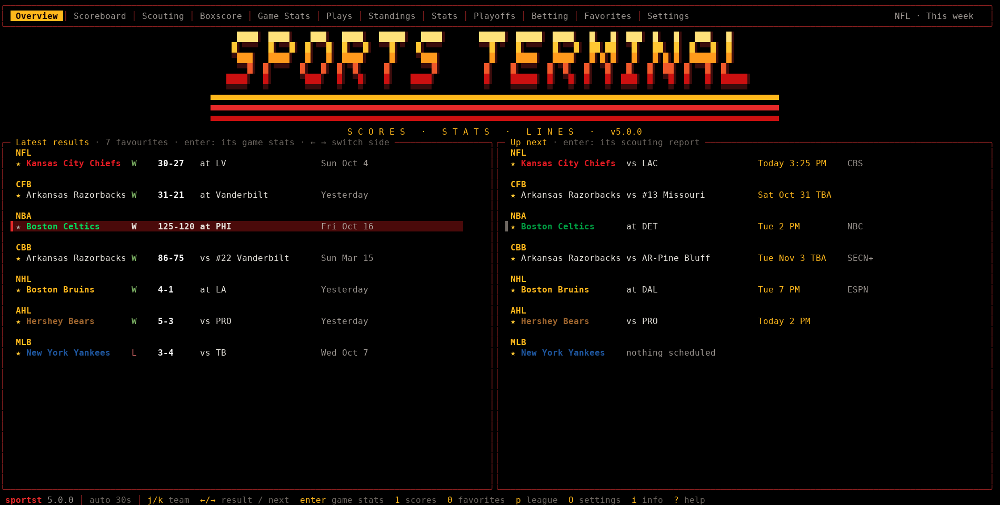
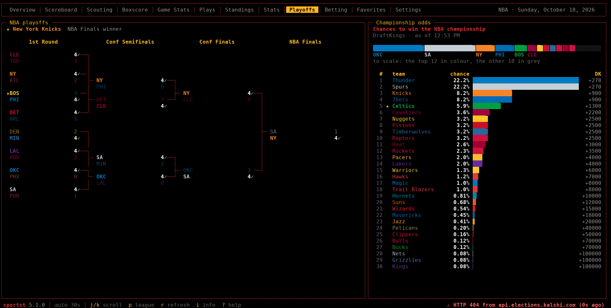
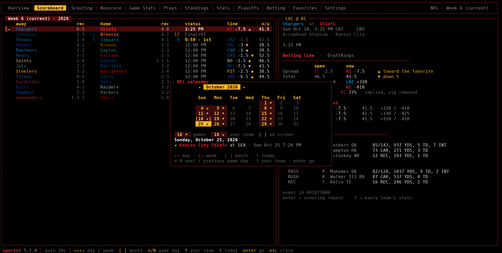

# sportst

**A terminal scoreboard for the NFL, college football, the NBA, men's college basketball, the NHL, the AHL, MLB, NCAA Division I college baseball, and the Winter and Summer Olympics.**

Scoreboard, scouting reports, box scores, every team's season stats, plays, standings, brackets, betting lines with sportst's own value picks, and favorites over ESPN's public API, the AHL's own HockeyTech feed, and Wikipedia for the Olympic sports ESPN does not cover - with the NHL's and MLB's own stats APIs and NCAA.com filling in the team numbers ESPN does not publish, and Action Network and Kalshi supplying every sportsbook's line.

Pick any scoring play on the Plays tab and hear its clip, with the broadcast call, right in the terminal - from ESPN's and MLB's free clips, the NHL's goal clips, and the NFL's and AHL's own YouTube channels.

It opens on an Overview of your favorite teams - each one's latest result and next game under a retro SPORTS TERMINAL title - and has a Settings tab that changes every option, shows how every data source is doing, and lists every key.

One Python file with no dependencies: the standard library only.

## Quick start

You need Linux or macOS (Windows works inside WSL), Python 3.9 or newer, and a terminal with UTF-8 and 256 colours. Nothing else - sportst is one Python file that uses only the standard library.

```bash
# get it: clone this repository, or download just the sportst file from it
git clone <this repository's URL>      # the green "Code" button on GitHub copies it
cd sportst

# install it for your user
mkdir -p ~/.local/bin
cp sportst ~/.local/bin/sportst
chmod +x ~/.local/bin/sportst

# run it
sportst --version
sportst
```

If your shell says `command not found`, `~/.local/bin` is not on your `PATH` yet - section 2 covers that, along with upgrading and uninstalling. To hear clips of scoring plays in the terminal, also install a media player such as mpv (`sudo apt install mpv` on Debian, Ubuntu or Mint). It is optional; without one, clips open in your browser.

### Your own settings

The repository ships with no one's settings and no favourite teams. sportst keeps yours in `~/.config/sportst/config.json` (or `$XDG_CONFIG_HOME/sportst/`), which it creates the first time you change something. There are three ways to set it up:

- **In the app.** Press `0` for the Favorites tab and star your teams (`L` switches league). Press `O` for the Settings tab: every option, its default and what it does, saved the moment you change it.
- **From a template.** `sportst --write-config` writes a config file with every setting at its default, ready to edit.
- **For one run.** `sportst -L nhl` opens a league, `sportst --config path/to/other.json` uses another config file.

A config file only needs the keys you want to change; anything it leaves out uses the default. Section 17 lists every key. Cached logos, pages and saved betting lines go in `~/.cache/sportst/`; nothing else is written anywhere, and no account or API key is needed for any of the data sources.

| Overview | Championship odds | Calendar |
| --- | --- | --- |
|  |  |  |


## Contents

1. [What it does](#1-what-it-does)
2. [Install](#2-install)
3. [The leagues](#3-the-leagues)
4. [The league picker](#4-the-league-picker)
5. [The Olympics](#5-the-olympics)
6. [The screens](#6-the-screens)
7. [Scouting reports](#7-scouting-reports)
8. [The Stats tab, Top 25 and conference filters](#8-the-stats-tab-top-25-and-conference-filters)
9. [The Betting tab and value picks](#9-the-betting-tab-and-value-picks)
10. [Baseball: the Plays screen](#10-baseball-the-plays-screen)
11. [Basketball: the shot chart](#11-basketball-the-shot-chart)
12. [Playoffs](#12-playoffs)
13. [Betting lines and upset watch](#13-betting-lines-and-upset-watch)
14. [Colours and logos](#14-colours-and-logos)
15. [Favorites](#15-favorites)
16. [Keys](#16-keys)
17. [Config](#17-config)
18. [Command line](#18-command-line)
19. [Troubleshooting](#19-troubleshooting)
20. [Where the data comes from](#20-where-the-data-comes-from)
21. [Privacy and API keys](#21-privacy-and-api-keys)
22. [Notes if you want to extend it](#22-notes-if-you-want-to-extend-it)

## 1. What it does

sportst is a full-screen scoreboard that runs in a terminal window. It is one Python file with no dependencies to install, and it reads free, public sports data - no account, no sign-up, no API key.

### Leagues

NFL, college football, NBA, men's college basketball, NHL, AHL, MLB, college baseball, and the Winter and Summer Olympics.

### For every game

Live scores and clocks, line scores, box scores, team stats drawn as two-colour bars, game leaders, and a Plays screen: scoring plays and drives for football, goals and penalties for hockey, a pitch-by-pitch strike zone for baseball, and a to-scale shot chart for basketball. Pick a scoring play and press enter to hear its clip (section 6).

### Before every game

A scouting report: the line, ESPN's win predictor, the weather, each team's recent form, season leaders, the full injury list and the latest news, and every season stat side by side - with the matchup edges (one team's strength against the other's weakness) called out in colour so they jump off the screen.

### Betting

A Betting tab with every upcoming game's line averaged over FanDuel, DraftKings and BetMGM (or any one sportsbook, or the best price at any of seven), the public's bets and money, line moves, a prediction-market price, and sportst's own projection - with the bets it rates as value flagged and sized.

### For every league

A Stats tab with every team's offensive, defensive and special-teams numbers on one sortable screen, standings, the playoff bracket (or the playoff picture before the postseason), betting lines with upset alerts where they are posted, and favorite teams that float to the top of every list. College sports filter by Top 25 and by conference; the pros by conference and division.

### The Olympics

The hockey, basketball, football and baseball tournaments look like the pro leagues; every other sport lists its events with podiums and full round-by-round results; there is a medal table; your favorite nations are starred everywhere.

### Your teams first

sportst opens on the Overview: a retro SPORTS TERMINAL title, then every favorite team's latest result and next game (or the game it is playing right now), one keypress from the box score or the scouting report.

### Settings

A Settings tab that changes every option while the app runs, shows sportst's version, files and cache, every free data source with how its requests are going, and every key and command-line option.

It also looks the part: every team in its own colours, the winner's logo drawn in the corner of the screen, and four retro broadcast colour schemes - ESPN, ABC Sports, CBS Sports and NBC Sports styles. Every screen can also be printed as plain text for scripts (section 18). The keys that matter on each screen are always listed along the bottom line.

## 2. Install

About five minutes, start to finish. Every command below is typed into a terminal window; lines starting with # are comments you do not type.

### What you need

A computer running Linux or macOS. (Windows works inside WSL, the Windows Subsystem for Linux - see "On Windows" below.)

Python 3.9 or newer. Most Linux distributions and macOS already have it. Check with:

```
python3 --version
```

If that prints "command not found", install it:

```
sudo apt install python3        # Debian, Ubuntu, Linux Mint
sudo dnf install python3        # Fedora
sudo pacman -S python           # Arch
brew install python             # macOS with Homebrew
```

A terminal that does UTF-8 and at least 256 colours. Any modern Linux terminal (GNOME Terminal, Konsole, Tilix, Kitty, Alacritty, WezTerm, xterm) and macOS's Terminal or iTerm2 all qualify. The minimum size is 50 columns by 10 rows; 110 columns or more gives the side-by-side panes, and around 190 fits everything at once.

An internet connection. Nothing is downloaded at install time; the scores are fetched while it runs.

Optional, for scoring-play clips: a media player that can play a web address - mpv (recommended), ffplay (part of ffmpeg) or VLC. sportst plays the clip's sound through it right in the terminal. Without one, clips open in your web browser instead.

```
sudo apt install mpv            # Debian, Ubuntu, Linux Mint
sudo dnf install mpv            # Fedora
sudo pacman -S mpv              # Arch
brew install mpv                # macOS with Homebrew
```

### Step 1 - Get the file

Save the file called sportst somewhere you can find it, for example your Downloads folder. It is the whole program. Open a terminal and go to that folder:

```
cd ~/Downloads
```

Check that it is the right file (the first line names Python) and that it is intact (the second command prints nothing if it is):

```
head -1 sportst                 # #!/usr/bin/env python3
python3 -m py_compile sportst
```

### Step 2 - Try it without installing (optional)

You can run it straight from where it is:

```
python3 sportst --scores        # prints today's NFL slate and exits
python3 sportst                 # the full-screen app; q quits
```

### Step 3 - Install it for your user

This puts it in ~/.local/bin, the usual place for your own programs. No sudo needed:

```
mkdir -p ~/.local/bin
cp sportst ~/.local/bin/sportst
chmod +x ~/.local/bin/sportst
```

### Step 4 - Make sure your shell can find it

Check whether ~/.local/bin is already on your PATH:

```
echo "$PATH" | tr ':' '\n' | grep -x "$HOME/.local/bin"
```

If that prints the folder, skip to step 5. If it prints nothing, add it, using the line for the shell you use (echo $SHELL tells you):

```
# bash - the default on most Linux systems
echo 'export PATH="$HOME/.local/bin:$PATH"' >> ~/.bashrc
source ~/.bashrc
```

```
# zsh - the default on macOS
echo 'export PATH="$HOME/.local/bin:$PATH"' >> ~/.zshrc
source ~/.zshrc
```

```
# fish
fish_add_path ~/.local/bin
```

Other terminal windows that were already open need to be closed and opened again to see the change.

### Step 5 - Check it and run it

```
sportst --version               # sportst 5.1.1
sportst --scores -L nba         # plain text: a quick network check
sportst                         # the app
```

Press ? inside the app for the key list, p to pick a league, q to quit.

### Step 6 - Check your font (optional, one minute)

Team logos and the basketball shot chart use block and braille characters. Almost every Linux and macOS terminal draws them, but to be sure:

```
sportst --logo-test
```

prints the same logo in five styles. If the first one ("sextants") looks clean, you are done. If it shows empty boxes, pick the sharpest style that does draw and put it in the config file (step 7):

"logo_art": "quadrants"

If basketball shot charts show boxes where the court lines should be, add:

"court_lines": "dots"

### Step 7 - Settings (optional)

sportst runs with sensible defaults and no config file. To change them, write one out and edit it:

```
sportst --write-config
# that creates ~/.config/sportst/config.json
nano ~/.config/sportst/config.json
```

Section 17 explains every setting - which league opens first, refresh speed, colours, betting lines on or off, and so on. Favorites are picked inside the app on the Favorites tab and saved to the same file automatically.

### Installing for every user instead

If you would rather install it system-wide:

```
sudo install -m 755 sportst /usr/local/bin/sportst
```

Each user still gets their own settings and favorites.

### On Windows

Windows' own Python has no curses module, which sportst needs for the full-screen app. Install WSL (in PowerShell as administrator: wsl --install, then restart), open the Ubuntu terminal it adds, and follow the Linux steps above. To copy the file in from Windows:

```
cp /mnt/c/Users/YOUR-WINDOWS-NAME/Downloads/sportst ~/
```

### Upgrading from an earlier version (for example 5.0 to 5.1.1)

Your settings and favorites live in ~/.config/sportst and are not touched by an upgrade, so this only swaps the program file.

1. Quit sportst if it is running (q), in every terminal window.

2. Find where the old copy is installed:

```
command -v sportst
# usually /home/YOU/.local/bin/sportst
# or /usr/local/bin/sportst for a system-wide install
```

3. Note the old version, then remove the old program:

```
sportst --version               # e.g. sportst 5.0.0
rm ~/.local/bin/sportst
# system-wide install instead: sudo rm /usr/local/bin/sportst
```

4. Make the shell forget the old location:

```
hash -r                         # bash and zsh; fish needs nothing
```

5. Install the new file, from the folder you saved it in:

```
cd ~/Downloads
python3 -m py_compile sportst   # prints nothing if the file is intact
cp sportst ~/.local/bin/sportst
chmod +x ~/.local/bin/sportst
# system-wide instead: sudo install -m 755 sportst /usr/local/bin/sportst
```

6. Check it:

```
sportst --version               # sportst 5.1.1
sudo apt install mpv            # optional: hear clips in the terminal
sportst                         # pick a game, 5 for Plays, j and enter
```

7. Optional: clear the cache. Nothing in 5.1.1 needs it, but it is safe - logos and Olympic pages are simply fetched again:

```
rm -rf ~/.cache/sportst
```

The Settings tab can do this too: "Clear logo & page cache" under Actions (your line history is kept).

To go back, copy the old file in the same way; older versions ignore the settings they do not understand.

### Uninstalling

```
rm ~/.local/bin/sportst          # the program
rm -rf ~/.config/sportst         # settings and favorites
rm -rf ~/.cache/sportst          # cached logos, pages, lines
```

### Files it creates

```
~/.config/sportst/config.json      settings and favorite teams
~/.cache/sportst/lines.json        betting-line history
~/.cache/sportst/logos/            team logos, fetched once each
~/.cache/sportst/wiki/             Olympic results pages
~/.cache/sportst/ncaa-baseball-stats.json
                                   college baseball team stats from
                                   NCAA.com, kept for 12 hours
```

Nothing else is written. If you set XDG_CONFIG_HOME or XDG_CACHE_HOME, those folders are used instead.

### If something goes wrong

**"sportst: command not found"**

~/.local/bin is not on your PATH yet: do step 4, then open a new terminal.

**"Permission denied"**

The file is not marked executable: chmod +x ~/.local/bin/sportst

**"/usr/bin/env: 'python3': No such file or directory"**

Python is not installed: see "What you need" above.

**"ModuleNotFoundError: No module named '_curses'"**

This is Windows' own Python; use WSL (see "On Windows").

**"sportst: not a terminal"**

The full-screen app needs a real terminal window. When piping into another program or running from a script, use the plain-text modes such as --scores (section 18).

**"Terminal too small"**

Make the window at least 50 columns wide and 10 rows tall.

**The colours look wrong or washed out**

Try running with TERM=xterm-256color sportst, or add --no-true-color. Section 14 covers colours and backgrounds.

**"Could not reach ESPN" or a DNS error at the bottom of the screen**

The network is down or blocked (a firewall, VPN or proxy). sportst retries on its own; r retries straight away.

**Clips open in the browser instead of playing**

No media player was found. Install mpv (sudo apt install mpv) and press enter again; Settings shows which player sportst found. If you chose "the browser" under Settings, Clips, set it back to auto.

**A clip plays but there is no sound**

Check the player on its own: mpv --no-video followed by any web address of a video. If that is silent too, it is the system's sound settings, not sportst.

## 3. The leagues

Press L to cycle through them, p to pick one from a menu, or start in one with -L:

```
nfl     NFL                     week based
cfb     college football        week based, FBS by default
nba     NBA                     day by day
cbb     college basketball      day by day, every Division I game
nhl     NHL                     day by day
ahl     AHL                     day by day
mlb     MLB                     day by day
cbase   college baseball        day by day, NCAA Division I
owg     Winter Olympics         a whole Games at once; e picks the sport
osg     Summer Olympics         a whole Games at once; e picks the sport
```

Football opens in week mode; basketball, hockey and baseball open on today's date. Press w to put football into day mode for a single Saturday's slate.

The Olympics open on the Games under way, or starting within six weeks, or else the most recent one: Milano Cortina 2026 for the winter, Paris 2024 for the summer until LA 2028 comes round. h and l step to the previous or next Games; t comes back.

## 4. The league picker

p opens a menu over whatever you are looking at:

```
1  NFL               National Football League
2  CFB               College Football (FBS)
3  NBA               National Basketball Association
4  CBB               Men's College Basketball (NCAA Division I)
5  NHL               National Hockey League
6  AHL               American Hockey League
7  MLB               Major League Baseball
8  CBASE             College Baseball (NCAA Division I)
9  Winter Olympics   Milano Cortina 2026
0  Summer Olympics   Paris 2024
```

j and k (or the arrows) move, enter picks, and a digit jumps straight to that league without enter (0 is the tenth). / filters the list, esc closes it. L keeps cycling through the same ten in order, for when you only want the next one.

You stay on the same tab where the new league has one: looking at the NHL standings and picking the AHL takes you to the AHL standings.

## 5. The Olympics

### Picking a sport

Press e in either Olympics. The menu lists that Games' team tournaments first (hockey, basketball, football, baseball - men's and women's are separate entries), then every other sport, then the other Games on file. / filters it: type skat and you get figure skating, short track and speed skating. The sport you picked last is where that Olympics opens next time.

### Team tournaments

ESPN covers these game by game, so they look like the pro leagues:

```
Scoreboard     every game of the tournament, dated, with the group or
               round in the detail pane and the winner's flag
Boxscore       skaters and goalies, or the basketball box, or each
               footballer's goals, assists, shots, cards and saves
Team Stats     bars for shots, possession, rebounds, corners...
Plays          hockey: goals, strength and penalties by period;
               basketball: every scoring play with the running score;
               football: goals, cards and substitutions by minute;
               baseball: the pitch-by-pitch screen
Standings      the group tables
Medal Round    the knockout bracket from the first playoff to the
               gold medal game, with the bronze game beside it
Medals         the whole Games' medal table
Favorites      nations
```

### Every other sport

Wikipedia keeps a results page for every Olympic event, updated within minutes during a Games, and sportst reads it:

```
Events         every medal event of the sport on the left, with the
               nations that took gold, silver and bronze; the right
               pane has the venue, dates and field, the medallists,
               the top of the final standings and a line about how it
               went
Results        every table on the event's page: heats, semi-finals and
               the final in athletics; both runs in the giant slalom;
               the short program, free skate and overall in figure
               skating; round robin and draws in curling
Medalists      the sport's medal summary and its schedule
Medals         the Games medal table
Favorites      nations
```

Nations show as their IOC code in their own colour (USA, CAN, NOR); medal places are gold, silver and bronze; a favorite nation's rows are starred and bold wherever they appear.

### Which Games are on file

Milano Cortina 2026 and French Alps 2030 (winter); Paris 2024 and LA 2028 (summer), LA with its five new sports: baseball, softball, cricket, flag football, lacrosse and squash. Games that have not happened yet show their sports with empty schedules until ESPN and Wikipedia fill them in.

## 6. The screens

### Overview (H - where sportst opens)

A retro SPORTS TERMINAL title in the colours of your scheme, then one row per favorite team, grouped by league: its latest result on the left (W or L, the score with the team's own first, vs or at the opponent, the day) and its next game on the right (the opponent with its ranking in college, the day and start time in your time zone, and the TV network). A team playing right now shows LIVE with the score and the clock instead. On a narrow terminal the next game sits on the line under the result.

Each team has two games to choose from: its latest result on the left and its next game on the right. j / k pick the team; left and right (or h and l, or tab) move the highlight between its result and its next game - the side you are on is highlighted, the other carries a faint marker. Enter on a result opens that game's Game Stats tab; enter on a next game opens its Scouting report (or its Game Stats if it is being played right now). b opens the latest result's Game Stats from either side. Either way sportst switches to that team's league and day, so 1 then shows that whole slate. A game whose kick-off time has not been announced shows "TBA" on its real date. With no favorites yet it says how to add them (0 is the Favorites tab). Olympic nations stay on the Olympic tabs.

### Scoreboard (1)

The slate on the left, the selected game on the right. Baseball shows innings with R, H and E, the count, the outs and who is on base while a game is live, and the probable pitchers before it starts. When a game is final the winning team's logo is drawn under the detail pane. c filters to one conference or division and f to the Top 25 in college sports (section 8). Enter on a game that has not started opens Scouting; on any other game it opens the Boxscore.

### Scouting (2)

The scouting report for the highlighted game - section 7.

### Boxscore (3)

Two panes: the home team on the left, the away team on the right, both scrolling together. Baseball gets batting and pitching lines; hockey gets skaters and goalies; football gets passing, rushing, receiving and defence. Tables that are too wide for half a screen drop their least useful columns rather than running off the edge.

### Game Stats (4)

This game's comparison card (called Team Stats before 4.2): one line a stat, the two teams' numbers either side of a two-colour bar in their own colours, the rest of the team stats as a table under it, and the game leaders beside it - all on one screen. Baseball compares runs, hits, home runs, extra-base hits, walks, strikeouts, stolen bases, runners left on base and errors, and lists the best hitter and pitcher on each side, taken from the box score.

### Plays (5)

One line at the top for the score, status, venue, crowd and weather, then two panes. Football: every score on one line each (quarter, clock, team, kind, score, what happened) and the win-probability chart on the left; every drive (quarter, team, result, plays, yards, time, start) and the officials on the right. Hockey (NHL, AHL, Olympic): goals one line each with their strength and assists, and the three stars, on the left; shots on goal by period, penalties and officials on the right. Baseball gets the pitch-by-pitch screen (section 10) with the game's scoring plays under the strike zone; basketball gets the scoring plays and the shot chart (section 11).

### Scoring-play clips (on Plays)

j / k highlight a scoring play - every touchdown and field goal, goal, run or basket - and enter plays its clip. The mark beside each play says what enter will do:

```
♪   a clip with sound: it plays right here, sound only, through
    mpv, ffplay or VLC (whichever is installed), and the bottom
    line shows what is playing
↗   a clip on a web page (nhl.com or YouTube): it opens in your
    browser
▶   the play whose clip is playing now; enter on it again, or x,
    stops it
(no mark)  no free source has a clip of that play; enter opens a
    YouTube search for it in your browser
```

n and N jump straight to the next or previous play with a clip - in basketball, with well over a hundred scoring plays, that is the quick way round. y plays the whole game's highlights. J and K scroll the screen while j and k move between plays.

Where the clips come from - all free, no account, no key:

```
College football, NBA,   ESPN's one-play clips, the same ones
college basketball,      espn.com shows.  ESPN clips the big
college baseball         moments, so a touchdown usually has
                         one; an ordinary field goal or basket
                         often does not.
NHL                      ESPN's goal clips, played here; for a
                         goal ESPN did not clip, the NHL's own
                         clip on nhl.com, in the browser.
MLB                      MLB's own highlight clips (the MLB Stats
                         API), played here; most scoring plays
                         have one.
NFL, AHL                 the league's official YouTube channel,
                         in the browser.  Its public feed lists
                         only the most recent uploads, so this
                         works best on game day; older plays get
                         a YouTube search instead.
```

Clips are matched to plays by the players' names, the distance and the kind of play (a dunk's clip is never paired with a jumper), so a play is left unmarked rather than given someone else's clip. The commentary is whichever broadcast the clip was cut from - usually the national or one team's TV call - not a particular local radio call, which no free service publishes.

Settings, Clips chooses the player (auto, mpv, ffplay, VLC, or always the browser), whether the player opens a video window as well as the sound, and whether YouTube is used for the NFL and AHL. Leaving sportst stops whatever is playing.

### Standings (6)

Divisions flow into as many columns as your terminal fits. At 190 columns the entire NFL fits on one screen. c shows a single conference or division and / finds a team by name - handy in college basketball's 32 conferences.

### Stats (7)

Every team in the league, one row each, with a column per season stat - section 8.

### Playoffs (8)

The bracket, or the playoff picture before there is one, with every team's championship odds and a chart of them beside it. See section 12.

### Betting (9)

Every upcoming game's line and sportst's value picks - section 9.

### Favorites (0)

Pick two or three teams per league; they float to the top of every list and fill the Overview.

### Settings (O, the last tab)

Left: every setting sportst has, grouped (General, Display, Data sources, Betting, Upset watch), each with its current value; a gold value differs from the default. Under the list, the highlighted setting is explained, with its default, its config.json name and whether it takes effect now or at the next start. j / k move, enter or space changes it (switches it, lists the choices, or asks you to type a number, a colour or the sportsbooks), h / l step it down or up, R puts it back to its default. Every change is saved to config.json at once, and all but the start-up league take effect immediately - a new colour scheme repaints the screen as you step through them.

Actions at the bottom of the list: save now (which also keeps the auto-refresh state and interval set with a, + and -), reload config.json after editing it by hand, refresh all data, clear the logo and page cache, clear the betting-line history, and reset every setting to its default (favorites and team colour overrides are kept). The clearing and the reset ask you to type yes first.

Right (J / K scroll it): sportst's version, Python, the terminal's size and colour depth, how long it has been running and how many requests it has made, where config.json and the cache are and how big the cache is; then every data source - what it supplies, its host, and how this run's requests to it have gone (worked, failed, how long the last one took, how long ago), with the sources the current league uses in bright text and the last failure in orange; then the recent problems; every key; and every command-line option.

### The calendar (C, on any tab)

A month calendar pops out over whatever you are looking at. Days with games in the league on screen are lit (on a tint of the scheme's colour, with a dot); days one of your favorite teams plays carry a ★; today is underlined, and the day on screen now is in [brackets]. Under the month, the highlighted day is spelled out with your teams' games on it - opponent and start time, or the result.

```
← → (h l)        a day back / forward
↑ ↓ (k j)        a week
[ ]  PgUp PgDn   a month
n N              the next / previous day with games
f                your teams' next game
t                today
enter or space   go to that day
esc, q or C      close
```

Going to a day opens that day's games. On a game's tabs (Scouting, Boxscore, Game Stats, Plays, Betting) you stay put and the first game of the day - or your team's, when it plays - is the one shown; from Overview, Standings, Stats, Playoffs, Favorites and Settings the Scoreboard opens. Football switches to day view for the date; w goes back to weeks. Game days come from ESPN's season calendar (for football, that month's schedule) and HockeyTech's season schedule for the AHL; your teams' days from each team's own schedule. The Olympic sports already show their whole schedule, so C does nothing there.

### The bottom line

Next to the name and version, the bottom line always lists the keys that matter on the screen in front of you - j/k game, enter open, h/l week, c conference and so on - changing as you move between tabs, a team's players, Settings and pop-ups. Messages take the right-hand end; when one needs the room the last hints step aside.

### Info (i, on any screen)

A pop-up that explains the screen you are on: every column heading and abbreviation, every symbol and colour, how each number is worked out (the Betting tab's edge, stars and stake included), and the sport's own terms. It is built for the screen in front of you - the league, the game, the player view - and the box-score and standings abbreviations come with ESPN's own descriptions. j / k scroll it, any other key closes it.

The Olympics add Medals, swap Playoffs for Medal Round and have no Betting tab (no sportsbook feed covers them); the sports Wikipedia covers have their own screens between Overview and Settings. See section 5.

## 7. Scouting reports

Highlight a game that has not started on the Scoreboard and press enter, or press 2 at any time. Every league has it, the Olympic tournaments included. The screen is two panes that scroll together (one stacked pane on a narrow terminal).

### Left pane - the matchup

The start time, venue and TV; the betting line; ESPN's matchup predictor; the forecast for outdoor games; the season series.

Stat edges counts how many season stats each team ranks better in, and how many of those are big gaps.

Matchup advantages to watch lists the places one team's strength meets the other team's weakness - a top-five rushing attack against a bottom-ten run defence, a hot power play against a leaky penalty kill - strongest first. Each is printed in the team's colour; a filled triangle marks the biggest ones. Ranks are league-wide (#1 of 32 in the NFL, #1 of 365 in college basketball).

Below that, every season stat side by side, grouped into Offense, Defense, Special teams and so on: each team's number and league rank, with the better number lit in that team's colour. An orange arrow points at the side of a big gap (a third of the league or more apart).

### Right pane - each team

Form: the last five results. Season leaders (passing, rushing, receiving, sacks, tackles; points, rebounds, assists; goals and points; batting and pitching). The full injury list from the team's roster, grouped Out, IR, Doubtful, Questionable, Day-to-day. The latest headlines from ESPN's team news, with their age.

The AHL report comes from the league's own game preview instead: last ten, streak, home and road records, power play and penalty kill (home and road too), leading scorers, players on a point streak, the top rookie, records when leading or trailing after two, and the season series.

Before a season's first games the season numbers are last season's where the source still serves them; the records read 0-0. College teams rarely publish injury reports, so an empty list there means "none listed".

## 8. The Stats tab, Top 25 and conference filters

The Stats tab (7) puts every team in the league on one screen: a row per team, a column per season stat, with the league's best fifth in green and worst fifth in red. The # column is the team's league rank in the column you sort by. ] and [ narrow it to one conference or division at a time (see "One conference or division" below). The conf (or div) column names each team's conference or division. The top line and the two header rows stay put while the teams scroll.

### Players

j / k move the highlight down the teams; enter opens that team's player statistics for the season:

```
left     offense - football passing, rushing and receiving;
         basketball scoring per game; hockey scoring; baseball
         batting
right    defense - football tackles, sacks, TFL, passes defended,
         interceptions, forced fumbles; basketball rebounds,
         steals, blocks, fouls; hockey goaltending and plus-minus,
         ice time and penalty minutes; baseball pitching
bottom   special teams - football kicking, punting and returns;
         hockey power play, short-handed and faceoffs; basketball
         minutes and usage; baseball fielding
```

[ and ] step to the previous or next team in the table's order, j / k scroll, and esc (or enter or backspace) goes back to the table. The numbers come from ESPN's team-stats pages (the AHL's from HockeyTech); the Olympic tournaments publish none.

### Season or last game

g switches the player screen between the whole season and the team's last game. The last game is the most recent one completed - in the postseason, regular season or preseason, whichever is latest, or last season's final game before a new one starts - named at the top right ("Sat Oct 17 · W 31-21 at VAN"). Its box score is laid out the same way: offense left (passing, rushing, receiving and fumbles; points, shooting, assists and turnovers; goals, assists, shots and ice time; batting), defense right (tackles, sacks and interceptions; rebounds, steals and blocks; goaltending, blocks, hits and takeaways; pitching), special teams underneath (kicking, punting and returns; power-play and short-handed ice time and faceoffs). Players who did not record anything are left out, bench players are dimmed, and each table ends with the team's total. g again goes back to the season; [ ] keep whichever view you are in. College baseball has no team schedule at ESPN, so its last game is on the Scoreboard instead.

```
g        next stat group.  On a wide terminal everything fits side by
         side; on a narrower one g steps through the groups (Offense,
         Defense, Special teams, Batting, Pitching, Fielding ...),
         showing as many neighbours as fit, then all of them.
[ ]      one conference (college) or division (pros) at a time: ] shows
         the next one and only its teams, [ the previous; stepping
         past the last comes back round to All teams
c        pick the conference or division from the full list
s        pick the column to sort by from a list; best is always first,
         so for points allowed or ERA the lowest is #1.  The same list
         orders the teams best first (the default) or by team name
         A-Z, and its "Only one conference" entry opens the c list
S        sort by the next column
/        find a team by name: "ala" leaves Alabama, Alabama A&M,
         Alabama State and UAB; an empty search shows everyone again
f        Top 25 only (college)
```

### One conference or division

The top line of the Stats tab always says what is on screen:

```
◂ SEC ▸  Southeastern Conference · 16 of 138 teams
```

] and [ step through the league's conferences or divisions in the order the c list shows them - for the NFL: AFC, AFC East, AFC North ... NFC West; for the NHL: Eastern Conference, Atlantic, Metropolitan, Western Conference, Central, Pacific; for college: every conference, A-Z - and only that group's teams are listed. # then becomes the team's place within the group in the sort column, and lg beside it its rank in the whole league; green and red still mark the league's best and worst fifth. The conf / div column drops out when every team on screen shares it. The choice also filters the Scoreboard, Standings and Betting tabs, as c always has, and it is kept per sport while the app runs.

### What the columns are

```
Football    points, yards, passing and rushing yards, yards per carry
            and per pass, completion %, passer rating, third downs,
            sacks allowed, giveaways; the same allowed by the defence
            plus sacks, interceptions and takeaways; field goal and
            extra point %, net punting, kick and punt returns,
            penalty yards.  All per game.
Basketball  points, FG%, 3P%, threes made, FT%, assists, offensive
            rebounds, turnovers; opponent points, FG% and 3P%,
            rebounds (all and defensive), steals, blocks, forced
            turnovers; margin and
            assist-to-turnover ratio.
NHL         goals for and against, shots for and against, shooting
            and save %, power play and penalty kill, power-play goals,
            faceoff %, shutouts, short-handed goals, penalty minutes.
AHL         points %, goals for and against, power play and penalty
            kill with their goals, short-handed goals for and
            against, penalty minutes.
MLB         runs, AVG, OBP, SLG, OPS, home runs, steals and strikeouts
            per game; ERA, runs allowed, WHIP, K/9, BB/9, HR/9 and
            opponent average; fielding % and errors.
College     runs per game, AVG, OBP, SLG, home runs per game, ERA,
baseball    WHIP and fielding % for every Division I team (NCAA.com).
Olympics    win %, margin, goals or points for and against.
```

### Top 25 and conferences

On the Scoreboard and the Stats tab, c opens a list of the league's conferences and divisions:

```
College football, basketball, baseball   every conference (SEC,
                                         Big Ten, ACC ...), plus
                                         divisions where one has
                                         them
NFL                                      AFC, NFC and the eight
                                         divisions
NBA, NHL, MLB                            both conferences or
                                         leagues and their divisions
AHL                                      the four divisions
```

Pick SEC and the scoreboard shows only games with an SEC team in them, and the Stats tab only SEC teams. "All teams" clears it. The choice is kept per sport while the app runs, and shows in the top-right corner ("· SEC").

f (or "Top 25" in the same list) keeps only ranked teams: the AP poll for football and basketball, the D1Baseball.com Top 25 for college baseball. It combines with a conference: SEC plus Top 25 is the ranked SEC teams.

College baseball's table is read from NCAA.com a page at a time, so the very first load takes up to a minute; after that it is kept on disk for 12 hours. ESPN's college baseball standings cover a handful of conferences, so the rest are filled in from each school's basketball conference; a few schools play baseball in a different one.

## 9. The Betting tab and value picks

Tab 9 lists every game on the current day (or football week) that has not started, one line each, with the selected game's detail underneath. The same filters work here: c for a conference or division, f for the Top 25, and h / l to move the day or week.

### The list, left to right

Columns: # (a value pick's rank), time, game, spread (the favourite's number and price), total, moneyline (away/home), win% (the market's chance for the favourite, vig removed, then sportst's), proj (projected score, away-home), bets·$ (the side most bettors are on: % of bets · % of money, lit when the money runs 10 points ahead of the bets), move (how far the line has moved since it opened: ▲ the favourite got stronger, ▼ weaker, ◆ the favourite flipped), best bet, edge, ★ rating and stake. Columns drop away, least useful first, on a narrow terminal.

### Which lines (b)

```
Top-3 average   FanDuel, DraftKings and BetMGM averaged - spreads and
                totals to the nearest half point, prices averaged as
                probabilities.  The default.
Best price      every bet checked at every book, and the best price
                shown with the book's name (FD, DK, MGM, CZR, 365, BR,
                BOV).  This is line shopping, the one edge anyone can
                take.
One sportsbook  FanDuel, DraftKings, BetMGM, Caesars, bet365,
                BetRivers or Bovada alone - the lines you would
                actually get at your book.
The choice is saved.  Change the three averaged with
"betting_top_books" (section 17).
```

### The detail

Left: every book's spread, total and moneyline (the best moneyline price in green), Action Network's consensus and the opening line, Kalshi's prediction-market price and how much has traded on it, and the public's share of bets and of money on each side of each market.

Right: sportst's read - the projected margin, win chances and score; the four estimates behind it with their weights; the adjustments; the market signals; and every bet with sportst's probability, its edge and a rating, then why the pick was made (the signals for and against).

### How sportst projects a game

The margin is a weighted blend of four estimates:

```
Market          55%   the consensus spread (or, in hockey and
                      baseball, the no-vig moneyline)
Kalshi          15%   the prediction market's price
ESPN predictor  15%   ESPN's matchup predictor (FPI / BPI)
Season stats    15%   each side's scoring for and against, the
                      home edge, and the adjustments below
```

The market carries the most weight because it is the hardest number to beat. The season-stats estimate is adjusted for what season numbers cannot know: a team's season leaders on the injury report (a starting quarterback is worth about 4 points; others less, scaled by Out / Doubtful / Questionable), back-to-backs in the NBA and NHL, short weeks and byes in football, recent form against the season average, and for outdoor football totals, wind, cold and rain. Each team's numbers are shrunk toward the league average until it has played enough games to trust them.

Win and cover chances start from the market's own no-vig probability and move only as far as sportst's margin differs from the market's, so sportst never disagrees with the market by accident of arithmetic. Totals work the same way: the market's total, nudged toward the season numbers and the weather.

### Value picks and the stars

A bet's edge is its expected return per $1 at the price shown: sportst's probability times the payout, minus the stake. A bet is a value pick when its edge clears "betting_min_edge" (3% by default):

```
★      edge at or above 3%
★★     6% or more
★★★    10.5% or more
```

Then it is checked against the independent signals - Kalshi, ESPN's predictor, the season numbers, sharp money (money running well ahead of bets), reverse line moves (most bets on one side, the line moving to the other) and line moves. A star comes off when more signals disagree than agree, and is added when three or more agree and none disagree. Moneylines at +300 or longer are never picked, and an edge over 15% or a price over +200 is held to one star: at those prices a big edge usually means news the model has not seen.

Stake is an eighth of the Kelly-criterion stake, in units of 1% of a bankroll, capped at 2 units - deliberately small, because the edges are estimates.

The list opens with the value picks first, ranked best to worst - most stars, then the biggest edge - each numbered in the # column and lit on an orange band so they are the first thing you see; the other games follow, best remaining edge first. s switches to plain start-time order (the picks keep their rank numbers and highlight) and back; m shows value picks only; enter opens the game's scouting report, where a one-line summary of sportst's read also appears.

### Coverage

NFL, college football (FBS), NBA, men's college basketball (Division I), NHL and MLB get every book, the public numbers and Kalshi. College baseball gets ESPN's single line where it has one; the AHL has no betting feed, so it gets sportst's projection only. Lines usually appear a few days before a game; early-season college basketball and far-off games may have none yet.

### Please bet responsibly

These are statistical estimates, not guarantees, and no model beats the market every week. Bet only what you can afford to lose, and only where sports betting is legal for you. Help is available at 1-800-GAMBLER.

## 10. Baseball: the Plays screen

Select an MLB or college baseball game and press 5. The screen splits in two.

Left, the live picture:

```
Top 7th        CHC 3  -  BOS 4
```

```
   o          2-1  count    OO. outs
*     o       third: C. Wong
   home
```

```
P  Aaron Civale            AB  Adley Rutschman (L)
```

```
This at-bat
  1  92 mph  Four-seam FB   Strike Looking    0-1   2,388 rpm
  2  86 mph  Splitter       Foul Ball         0-2   1,937 rpm
  3  79 mph  Curve          Ground Out        0-2   3,148 rpm
       97 mph off the bat   0 degree launch   40 ft
```

Rutschman grounded out to second, Wong to third.

Recent plays ...

A filled diamond is an occupied base, and the runner's name is beside it. The count and the outs come from the live game state while a game is in progress, and from the play stream otherwise.

Right, the strike zone as the catcher sees it, with every pitch of the at-bat numbered in the order it was thrown and coloured by what it was:

```
red      called strike
orange   swinging strike
green    ball
gold     foul
blue     in play
```

The box is the rule-book zone. For MLB it is the zone measured for that batter's stance on that pitch; college baseball has no such measurement, so a standard zone is drawn instead. Under the zone: how many pitches, the fastest and average speed of the at-bat, the fastest pitch of the game, the hardest ball hit, then home runs and everything that happened on the bases - steals, caught stealing, pick-offs, wild pitches, balks.

Press , and . to step back and forward through the at-bats. The screen always opens on the most recent one, and returns to it when you step past the end.

What each league gives you:

```
MLB               pitch type, speed, location, spin rate, exit
                  velocity, launch angle, distance, per-batter strike
                  zone, count, outs, runners, steals
college baseball  pitch location, result, count, outs, runners,
                  steals, hits.  No speeds or spin: nobody publishes
                  Statcast for college baseball.
```

Set "mlb_statcast": false in the config to skip MLB's feed and use ESPN's numbers alone. You lose spin rate, exit velocity, launch angle, distance and the per-batter zone; everything else stays.

## 11. Basketball: the shot chart

Press 4 on any basketball game. The left pane is the game's scoring plays by quarter (or half, in college) with the running score; the right pane is the shot chart:

```
⡏⠉⢹⠉⠉⠉⠉⠉⠉⠉⠉⠉⠉⠉⢹⠉⠉⠉⠉⠉⠉⠉⠉⠉⠉⠉⠉⠉⢹⠉⠉⠉⠉⠉⠉⠉⠉⠉⠉⠉⢹⠉⢹
⡇●⢸           ⢸    ⣀⣀⣀●⣀⡀   ⢸           ⢸●⢸
⡇●⢸ ○         ⢸   ●●●●●○⢀⡆  ○      ●    ⢸●⢸
⡇●⢸ ○      ○● ⢸   ●○●○●⣠●○  ⢸ ○         ⢸●○
⡇○⢸           ⢸     ●○⠉ ●   ⢸     ●     ⢸ ⢸
⡇ ⢸           ⢸  ○ ●● ○    ○⢸           ⢸○⢸
⡇●⠘⡆          ⢸ ○   ○   ○ ○○⢸○          ⡞ ⢸
⡇  ⠘⣆     ○   ⢸         ● ● ⢸○        ⢀⡞  ⢸
⡇  ○⠈⢢⡀  ○    ⠘⠒⢲⠒⠒⠒⠒⠒●⠒⠒⠒⢲⠒⠚ ●      ⣠●   ⢸
⡇     ○⢤⡀       ●⢆  ●    ⢀○    ●   ⣠●⠁○   ⢸
⡇     ● ⠙⠦⣀       ⠑⠤⣄●⣀⡤○⠁      ⢀⡠⠞●●     ⢸
⡇       ○ ●⠑⠲⢄⣀             ⢀⣀⠴⠒⠉○●       ⢸
⡇         ○ ●○○⠉○⠒⠒⠤⠤⠤⠤⠤⠔⠒⠒⠉⠁○●●●         ⢸
⡇               ○ ●○ ○●○●   ○             ⢸
⡇                                         ⢸
⡇                       ○   ○             ⢸
● made  ○ missed   SA 36/86   NY 36/78
```

The basket is at the top. ESPN records where every field-goal attempt was taken from, in feet, and both teams are put on the same half court. The court is drawn to regulation: the NBA's 23-foot-9 arc and 16-foot lane, college's 22-foot-1¾ arc and 12-foot lane, FIBA's for the Olympics. Free throws have no location and are left out; heaves from beyond 31 feet are counted under the chart instead of drawn.

Where two shots land in the same character cell, a make wins over a miss, and the team with more shots there gives the colour. Press v for one team at a time when both teams' colours are close.

By zone, under the chart:

```
Rim        within 4 feet of the basket
Paint      the rest of the lane
Mid        every other two-point attempt
Corner 3   threes from below the point where the arc meets the
           straight corner line
Arc 3      every other three
```

The court lines are drawn in braille dots, which put two by four dots in each character cell. Braille has been in Unicode since 1999 and Linux terminals fall back to a font that has it even when your own font does not, so it draws cleanly almost everywhere. If you see boxes instead, set "court_lines": "dots" for plain middle dots.

## 12. Playoffs

Press 8 (the Medal Round tab in an Olympic tournament). Rounds run left to right, each series wired back to the two it came from, so you can follow a team across the page:

```
1st Round              2nd Round            Conf Finals
```

```
(D1) BUF          4 v --+
(WC1) BOS         2     +-- (D1) BUF        3 --+
                        |   (D3) MTL        4 v |
(D2) TBL          3 ----+                       +-- (D1) CAR   4 v
(D3) MTL          4 v                           |   (D3) MTL   1
```

Seeds are in brackets, the series score or the game score is on the right, a check marks the winner, losers are dimmed, and the champion is named at the top. Your favorites are starred.

Where each bracket comes from:

```
NFL               ESPN postseason weeks, seeds from the standings
college football  ESPN bowl-season games, the twelve-team CFP only
NBA               ESPN's playoff games by month, folded back into
                  series with ESPN's own series scores
college hoops     the NCAA tournament from the round of 64, region by
                  region in seed order (the First Four is left out so
                  the bracket lines up)
NHL               the NHL's own published bracket, with its seeds
AHL               HockeyTech's Calder Cup bracket, with series wins;
                  the first round is best of three, the division
                  rounds best of five, the last two best of seven
Olympics          the knockout games, from the qualification playoffs
                  to the gold medal game, on the Medal Round tab
MLB               MLB's postseason schedule, folded back into series
college baseball  the College World Series and the championship
                  series.  Double elimination, so games are listed in
                  order rather than wired together - a bracket line
                  would imply something that isn't true.
```

### Championship odds

Beside the bracket (below it on a terminal narrower than 150 columns) every team's chance of winning the title - the Super Bowl, the national championship, the NBA title, the Stanley Cup, the World Series - from the latest prices:

```
Kalshi market   the team's price on Kalshi's championship market,
                a live prediction market, as a probability (the
                middle of the bid and the ask)
DraftKings      the sportsbook's futures odds as ESPN carries them
                (+450 pays $450 on $100), with the bookmaker's
                margin taken out before blending
```

The chance column blends the two and scales the field to 100%. At the top, the whole field is drawn as one strip to scale - each contender's share in its own colours, the long shots together in grey - and every team below gets a bar against the favourite's, with the market's price (mkt) and the book's odds beside it. Teams that are out drop off. The NHL has no sportsbook board on ESPN yet this season, so its odds are Kalshi's alone. The AHL and college baseball have no market or sportsbook at all, so sportst estimates theirs - the AHL from the standings (points percentage, pulled toward .500 early in the season), college baseball from the D1Baseball Top 25 - and says so above the chart. Prices refresh every 10 minutes (the book every 30); the panel shows when. The Olympics have no odds panel.

Before the postseason starts there is nothing to draw, so the screen shows the playoff picture instead: every team by seed, with a dashed line across the cut. College football has no seeds in September, so it shows the AP Top 25 with the line drawn after the twelfth team.

## 13. Betting lines and upset watch

Every game carries its line: the spread (the run line in baseball, the puck line in hockey), the over/under and both moneylines, with the opening number beside the current one and an arrow when it has moved.

In football the spread says who the favourite is. In hockey and baseball the spread is fixed at 1.5, so the moneyline decides it instead.

Upset watch: when a real favourite is losing, tied late, or barely ahead late, the game is tinted orange on the scoreboard and listed in the footer. Press u to jump to the next one, o to hide or show the line columns.

"Real favourite" means a spread of at least 3 points or a moneyline of -150 or shorter; both are adjustable. A three-run lead counts as safe in baseball, two goals in hockey, eight points in football.

ESPN drops the odds from its scoreboard the moment a game starts, so sportst keeps its own copy in ~/.cache/sportst/lines.json, recording every change it sees. If a game started before sportst ever saw the line, it asks ESPN's core endpoint, which still has it.

Run this from cron to keep tracking lines while the app is closed:

```
*/30 * * * * /home/you/.local/bin/sportst --scores -L nfl > /dev/null 2>&1
```

## 14. Colours and logos

### Team colours

Every team prints in its own primary colour, everywhere it appears. NFL, NHL, AHL, MLB and the college tables are built in, and Olympic nations have their national colours; anyone else falls back to the colour ESPN ships. College baseball uses the college football table, since they are the same schools.

Teams whose primary is black or near-black are drawn in their secondary instead, so they stay readable: Raiders, Bruins, Penguins, Kings, White Sox, Padres, Missouri, Iowa, UCF, Vanderbilt.

Two keys change this:

"team_color_overrides": { "mlb": { "SD": "#FFC425" } } "color_floor": 0.62

color_floor is how bright the strongest channel of a team colour must be, 0 to 1. Lower it to stay closer to the official values; raise it if your background is not very dark. "team_colors": false turns the whole thing off.

### The winner's logo

When a game is final, the winning team's logo is drawn in colour at the bottom left of the detail pane, at most 8 rows by 24 columns, shrinking if the pane is short. It is ESPN's own artwork, fetched once per team and kept in ~/.cache/sportst/logos/. AHL logos come from the league's own site; in the Olympics it is the winning nation's flag.

It is drawn with Unicode sextant characters: each character cell holds a 2 x 3 grid of pixels, in two exact colours. If your font draws it badly, run

```
sportst --logo-test
```

which prints the same logo in every style, and set the sharpest one that draws cleanly:

```
"logo_art": "sextants"    2 x 3 per cell (Unicode 13, 2020), the
                          default; "blocks" means this too
"logo_art": "octants"     2 x 4 per cell (Unicode 16, 2024) -
                          sharper where the font draws all 256
"logo_art": "quadrants"   2 x 2 per cell, classic Block Elements
                          (Unicode 1.0, 1991) - lower resolution
                          but every monospace font draws it evenly
"logo_art": "halfblocks"  2 x 1 per cell, works anywhere
"logo_art": "ascii"       .:-=+*#%@ in the logo's colours
"logo_art": "off"         no logo
```

sportst picks between ESPN's normal and dark-background version of each logo by which one reads better on black, so Clemson's paw stays orange and Iowa's hawk is gold rather than black. Anything black inside a logo is lifted to charcoal so the shape does not vanish.

### Colour schemes

The app's own colours - titles, headings, borders, the cursor bar, the tab bar, the Overview title - come from one of four schemes, each in the spirit of a network's sports graphics from the 1970s to the 90s:

```
Retro ESPN         flagship red titles and cursor bar, ticker gold
                   headings and active tab, cream text, on black
                   (the default)
Retro ABC Sports   bright yellow headings and cursor bar, white
                   titles, royal-blue borders, on deep blue
Retro CBS Sports   royal-blue titles and cursor bar, silver
                   headings and active tab, white text, on
                   blue-black
Retro NBC Sports   gold headings, orange titles, peacock-teal
                   borders and active tab, a purple cursor bar,
                   on ink
```

Pick one on the Settings tab (Display, Colour scheme): h / l step through them and the screen repaints as you go. In config.json it is "color_scheme": "espn", "abc", "cbs" or "nbc". Team colours are drawn on top of whichever you choose. The schemes are colour palettes only; sportst is not affiliated with any network.

### Everything else

Orange marks upset watch in every scheme. The app paints a solid background (each scheme brings its own), including the margins and the gaps between panes; changing the scheme moves the background with it unless you have chosen your own. "background": "terminal" gives your own terminal background back; any hex works too.

## 15. Favorites

Press 0 (5 in an Olympic sport), or tab across to Favorites. The top of the screen lists what you have picked in all ten leagues; below it is the team list for whichever league you are editing.

```
j k              move through the list
enter or space   star or unstar the highlighted team
/                search the list - type chie, get the Chiefs
x                clear the search
L                switch which league you are picking for
```

Starred teams float to the top of every list, in the order you added them: your games lead the scoreboard marked with a star, your team is starred in the box score and in the bracket, and the division holding a favorite is drawn first in the standings. Rows inside a division keep their real order, because that order is the standing.

In the Olympics the list is nations, not teams. A nation starred in the Winter Olympics is starred in every winter sport of every Games: its games lead the hockey scoreboard, its medals are marked in the event lists and results, and it heads the medal table under "Your nations".

Changes save to ~/.config/sportst/config.json immediately, and your teams appear on the Overview straight away.

## 16. Keys

### Moving around

```
j k   down up      next / previous game, or scroll a panel
J K                scroll the game detail on the right
enter              scouting report for a game not yet played, the
                   box score for any other
PgDn PgUp          jump ten games, or scroll a panel by a page
Home End           first / last
```

### Screens

```
H                  Overview, where sportst opens
1 ... 9, 0         the tabs after Overview: 1 Scoreboard, 2 Scouting,
                   3 Boxscore ... 9 Betting, 0 Favorites; what they
                   are depends on the league
O                  Settings
tab / shift-tab    next / previous screen
```

The bottom line always lists the keys for the screen you are on.

### Leagues and sports

```
p                  league picker: jump straight to any league
L                  cycle NFL, CFB, NBA, CBB, NHL, AHL, MLB, CBASE, the
                   Olympics
e                  Olympic sport picker (Winter or Summer Olympics)
```

### In a picker

```
j k  down up       move
enter              pick
1 ... 8            jump straight to that league (league picker)
/                  filter; backspace edits the filter
esc                clear the filter, then close
```

### Time

```
h l  left right    previous / next day, week in week mode, or Games in
                   the Olympics
[ ]                the same
t                  back to today, the current week, or the current Games
d                  jump to a date: 2026-09-13, 09/13, 13, yesterday
C                  the calendar (below)
w                  week mode / day mode (football only)
```

### Baseball

```
, .                step back / forward through at-bats on Plays
```

### Plays tab: clips

```
j k                pick a scoring play
n N                next / previous play that has a clip
enter              play its clip (again, to stop)
y                  the whole game's highlights
x                  stop the clip that is playing (on any tab)
J K                scroll the screen
```

### Basketball

```
v                  shot chart on Plays: both teams, away team only,
                   home team only
```

### Betting

```
u                  jump to the next game on upset watch
o                  show / hide the line and o/u columns
```

### Filtering

```
/                  find a team: type part of a name ("ala" finds
                   Alabama, UAB ...) and the Scoreboard, Standings,
                   Stats and Betting tabs show only the teams that
                   match (Olympic events: by name or nation); an empty
                   search clears it
c                  conference / division list (Scoreboard,
                   Standings, Stats, Betting)
f                  Top 25 only (college football, basketball, baseball)
```

### Overview tab

```
j k                pick a favorite team
left right, h l    its latest result / its next game
enter              a result: that game's Game Stats; a next game:
                   its Scouting report (Game Stats once it is live)
b                  the latest result's Game Stats, from either side
```

### Stats tab

```
j k, enter         pick a team; enter shows its players
[ ]  (table)       one conference / division at a time: previous /
                   next (back round to All teams)
c                  pick the conference / division from the list
esc, [ ]           back to the table; previous / next team
                   (in a team's player view)
g (players)        the season / the team's last game
g                  next stat group, then all of them
s                  choose the sort column (best first), or the
                   order: best first or team name A-Z
S                  sort by the next column
```

### Betting tab

```
j k / J K          pick a game / scroll its detail
b                  lines from: top-3 average, best price, one book
s                  best bets first (ranked) or start-time order
m                  value picks only
enter              the game's scouting report
```

### Settings tab

```
j k                pick a setting
enter or space     change it: switch it, list the choices, or type
                   a value (an action: do it)
h l  left right    step a value down / up, or the previous / next
                   choice
R                  back to its default
J K, PgDn PgUp     scroll the About side
```

### Everything else

```
r                  refresh now
a                  auto-refresh on or off
+ -                refresh interval up or down five seconds
ctrl-l             repaint, if something garbles the screen
i                  Info: what every column, symbol, colour and number
                   on the screen in front of you means
?                  key list
q                  quit
```

## 17. Config

```
sportst --write-config        # writes ~/.config/sportst/config.json
```

Almost everything below can be changed on the Settings tab (O) instead, which saves the file for you; the tab shows each setting's config name.

A config file only needs the keys you want to change; any key it does not have uses the default below.

```
league                 nfl          which league opens first: nfl, cfb,
                                    nba, cbb, nhl, ahl, mlb, cbase,
                                    owg, osg
refresh_seconds        30           poll interval; live games poll
                                    faster on their own
auto_refresh           true         poll in the background, or only on r
rounded_borders        true         curved or square box corners
cfb_group              80           ESPN conference group: 80 FBS,
                                    81 FCS, 8 SEC, 4 Big 12
favorites                           per-league lists, managed on the
                                    Favorites tab
color_scheme           espn         espn, abc, cbs or nbc (section 14)
team_colors            true         false turns team colouring off
color_floor            0.62         legibility floor for dark colours
team_color_overrides   {}           pin any team to any hex, per league
background             #000000      app background; terminal to show
                                    your own through
court_lines            braille      braille or dots, for the shot chart's
                                    court lines
logo_art               sextants     sextants (or blocks), octants,
                                    quadrants, halfblocks, ascii, off
olympic_events         {}           the sport each Olympics opens on,
                                    saved when you pick one with e
mlb_statcast           true         use MLB's own feed for spin, exit
                                    velocity and the per-batter zone
extra_stat_sources     true         fill the Stats and Scouting tabs
                                    from the NHL, MLB, AHL and NCAA
                                    stats services as well as ESPN;
                                    false uses ESPN alone (no college
                                    baseball stats then)
scouting_news          4            headlines per team on Scouting;
                                    0 hides the news
betting_book           avg          avg (top-3 average), best, or one
                                    book: FanDuel, DraftKings, BetMGM,
                                    Caesars, bet365, BetRivers, Bovada;
                                    set from the app with b
betting_top_books      FanDuel,     the three books averaged
                       DraftKings,
                       BetMGM
betting_min_edge       3.0          edge (%) a bet needs to be a value
                                    pick; ★★ at 2x, ★★★ at 3.5x
betting_sources        true         false: no Action Network or Kalshi,
                                    only ESPN's own line
betting_lines          true         false turns off lines and upset
                                    watch entirely
odds_provider          ""           prefer a sportsbook by name
upset_alerts           true         the orange highlight and the footer
upset_color            #FF6F00      the upset-watch orange
upset_min_spread       3.0          smallest spread that counts as a
                                    real favourite
upset_min_moneyline    -150         moneyline at or below which a team
                                    counts as a real favourite
upset_close_spread     7.0          how big a favourite must be for the
                                    CLOSE alert
upset_bell             false        ring the bell on a new alert
line_history_days      21           how long saved lines are kept
timeout_seconds        15           per-request HTTP timeout
api_host               site.api.espn.com   which ESPN host to try first
clip_player            auto         auto, mpv, ffplay, vlc or browser:
                                    what plays a scoring play's clip
clip_video             false        true: the player opens a video
                                    window as well as the sound
youtube_clips          true         false: no YouTube for NFL and AHL
                                    clips, and no YouTube searches
```

## 18. Command line

Every view also prints as plain text, in full colour when the output is a terminal and plain when it is a pipe.

```
sportst --scores                      today's slate with lines and IDs
sportst --scores -L mlb
sportst --scores -L cfb -w 4
sportst --scores -L nhl -d 2026-10-14
sportst --box 401817104 -L mlb        box score
sportst --team-stats 401817104 -L mlb one game's stats and leaders
sportst --plays 401817104 -L mlb      the pitch view as text
sportst --plays 401872924 -L nfl      scoring plays and drives
sportst --standings -L mlb            uses your full terminal width
sportst --stats -L nfl                every team's season stats
sportst --stats -L cfb --conference SEC   one conference
sportst --stats -L nhl --conference "Metropolitan Division"
sportst --stats -L cbase --json       the merged table as JSON
sportst --bets -L nfl                 lines, projections, value picks
sportst --bets -L cfb -w 9 --book best   next week, best prices
sportst --bets -L nba --book FanDuel  one sportsbook
sportst --playoffs -L nhl             the bracket
sportst --odds 401872933              line, movement, result
sportst --favorites                   your saved teams
sportst --logo-test -L mlb            which logo styles your font draws
sportst --scores -L ahl               today's AHL games
sportst --box 1028697 -L ahl          an AHL box score (HockeyTech id)
sportst --standings -L ahl
sportst --playoffs -L ahl             the Calder Cup bracket
sportst -L owg --list-events          every sport and its -E name
sportst --scores -L owg -E hockey-m   the Olympic men's hockey games
sportst --standings -L owg -E hockey-w   the women's groups
sportst --playoffs -L osg -E basketball-m   the medal round
sportst --scores -L osg -E swimming   every swimming event and podium
sportst --medals -L owg               the Games medal table
sportst --scores -L nba -d 2026-06-10
sportst --plays 401859966 -L nba      scoring plays and the shot chart
sportst --standings -L cbb            every conference
sportst --playoffs -L cbb             March Madness
sportst --medals -L osg --games 2024
sportst -L owg -E figure-skating      open the app on that sport
sportst --scores --json | jq '.events[].id'
```

--json prints ESPN's raw payload instead of the rendered view, for --scores, --box, --team-stats, --plays, --standings and --odds; with --stats it prints sportst's merged table of every source.

## 19. Troubleshooting

**The logo is a scatter of empty boxes, or looks glitchy or uneven.**

Run sportst --logo-test and set logo_art to the sharpest style that draws cleanly. "quadrants" uses only classic Block Elements from 1991, which every monospace font renders evenly.

**No pitch data on a baseball game.**

ESPN publishes pitch locations only for games it covers pitch by pitch. Spring training, some college games and older games have none; the screen says so rather than drawing an empty zone.

**Speeds are missing in college baseball.**

Nobody publishes pitch speeds for college baseball. Locations, counts, results, runners and steals are all there.

**The bracket is empty.**

Either the postseason has not started, in which case the playoff picture is shown instead, or that league's bracket is not published yet. College baseball's bracket only covers the College World Series and the championship series.

**The footer says DNS lookup failed.**

Your computer briefly could not look up an ESPN hostname. Each request retries once quietly, and the warning clears as soon as one succeeds. If it persists, check: resolvectl query site.api.espn.com

**Team colours look approximate.**

Your terminal does not allow palette redefinition, so colours map onto the 256-colour cube. Check that echo $TERM reports something ending in -256color. Nothing breaks either way.

**Colours look washed out or too bright.**

Lower color_floor toward 0.45.

**My terminal's colours look odd after a crash.**

```
printf '\033]104\007' resets the palette.  A normal quit handles it.
```

**Boxes drawn with qqqq.**

The terminal is not in UTF-8; check echo $LANG, or set "rounded_borders": false.

**Nothing loads and the footer shows an HTTP error.**

ESPN rate-limits occasionally. Press r. If one host is blocked on your network, set api_host to site.web.api.espn.com.

**College football is missing games.**

The default group is FBS only. Change cfb_group.

**An Olympic sport says "HTTP 429 from en.wikipedia.org".**

Wikipedia asks clients to slow down now and then. sportst makes one request a second at most and retries on its own; the page appears on the next refresh. Finished Games are kept on disk for a week in ~/.cache/sportst/wiki/, so each page is fetched once.

**An Olympic event shows no results table.**

Wikipedia fills the results in as the event happens; before then the page has the schedule and the entry list only. The medallists in the event list come from the sport's own page and usually appear first.

**College baseball's Stats tab says it is loading for a long time.**

The first load reads NCAA.com page by page through ncaa-api.henrygd.me, which allows a few requests a second; it takes up to a minute, once every 12 hours. The other leagues load in a second or two.

**A Stats or Scouting number shows "-".**

That source has no figure for that team yet - early in a season, for a team that has not played, or for a stat a league does not keep.

**The stats look like last season's.**

Before a new season's first games most sources still serve last season's totals; they switch over on their own.

**The Betting tab shows only one line, or "-" in every column.**

Action Network has not posted lines for those games yet (they usually appear a few days ahead), or api.actionnetwork.com is unreachable from your network. sportst falls back to ESPN's single line, and the projection still runs.

**A game shows no Kalshi row.**

Kalshi lists a market only for some games, and sportst ignores one whose bid and ask are too far apart to give a real price.

**The c list says it is still loading.**

The conference list comes from the standings, fetched in the background when a scoreboard opens. Try again a second later.

**The AHL shows "Could not reach HockeyTech".**

lscluster.hockeytech.com is the AHL's stats server. If it is down, so is the league's own website; try again in a minute.

### Which source is failing?

The Settings tab (O) lists every data source with this run's requests to it - how many worked, how many failed, the last error and when - and the recent problems underneath. If one ESPN host is blocked on your network, switch "ESPN host tried first" there.

## 20. Where the data comes from

### ESPN's public site API

Scoreboards, box scores, team stats, standings, team lists, rankings, betting lines and play-by-play for the NFL, CFB, NBA, CBB, NHL, MLB and CBASE - including every shot's location for basketball - and the Olympic hockey, basketball, football and baseball tournaments (those on site.web.api.espn.com). No key, no account.

### ESPN's team statistics, rosters and news (site.web.api.espn.com)

Every team's season numbers for the NFL, CFB, NBA, CBB and NHL - their own and their opponents', which is where the defence columns come from - every player's season numbers for the Stats tab's player screen, plus each team's roster with its injuries and the team news feed for the Scouting tab.

### ESPN's core API

Betting lines after a game has started, which the scoreboard drops, a sportsbook's championship futures (the Playoffs tab's odds), and the date windows of college baseball's championship rounds.

### MLB Stats API (statsapi.mlb.com)

Statcast for MLB only: pitch speed and spin, exit velocity, launch angle, distance and the strike zone measured for each batter. The game is matched to ESPN's by date and the two team names. No key, no account. Turn it off with "mlb_statcast": false.

### MLB Stats API, team totals (statsapi.mlb.com)

Every MLB team's hitting, pitching and fielding numbers for the Stats and Scouting tabs. No key.

### The NHL's own APIs (api-web.nhle.com, api.nhle.com/stats)

The playoff bracket, with the seeds and series scores the scoreboard does not carry, and team shots, faceoff %, power play and penalty kill for the Stats and Scouting tabs. No key.

### NCAA.com via ncaa-api.henrygd.me

College baseball's team stats for all of Division I and the D1Baseball.com Top 25. ncaa-api is a free, open-source service that reads NCAA.com's public stats pages and returns them as JSON. No key, no account; it asks clients to stay under five requests a second, which sportst does.

### HockeyTech (lscluster.hockeytech.com)

Everything for the AHL: scores, the live clock, box scores, goals and penalties, standings, teams, special-teams stats, player stats, game previews for the Scouting tab and the Calder Cup bracket. It is the league's own stats service, open, with the public key theahl.com uses (see section 21). Logos come from assets.leaguestat.com.

### Action Network (api.actionnetwork.com)

Every game's spread, total and moneyline at FanDuel, DraftKings, BetMGM, Caesars, bet365, BetRivers and Bovada, plus the consensus, the opening line and the public's share of bets and money, for the NFL, CFB, NBA, CBB, NHL and MLB. It is the public JSON the Action Network website itself loads; no key and no account, but it is not an official, documented API, so it could change without notice - if it does, the Betting tab falls back to ESPN's line. Turn it off with "betting_sources": false.

### Kalshi (api.elections.kalshi.com) - game and championship markets

Prediction-market prices for game winners and for each league's champion, from Kalshi's public market-data API. No key or account needed to read prices.

### Wikipedia (en.wikipedia.org)

The Olympic sports ESPN does not cover: each sport's page for its events and medallists, each event's page for its results, and each Games' medal table. Pages are read as rendered HTML with the standard library's html.parser, one request a second at most, and kept in ~/.cache/sportst/wiki/. The IOC's own live results feed is licensed to broadcasters only.

### ESPN's image CDN

Team logos and national flags, cached in ~/.cache/sportst/logos/.

### ESPN's team schedules (site.api.espn.com)

Each favorite team's latest result and next game for the Overview, and the last game a team played for the Stats tab's player screen. AHL teams use HockeyTech's schedule.

### Scoring-play clips

ESPN's game summaries list its one-play clips with a direct video address; MLB's Stats API lists every game's highlight clips the same way (statsapi.mlb.com/api/v1/game/.../content); the NHL's API links every goal to its clip page on nhl.com; and YouTube's public channel feeds (www.youtube.com/feeds/videos.xml, no key) list the NFL's and the AHL's latest uploads. sportst reads only those lists. The clip itself is fetched by your media player straight from ESPN's or MLB's video servers, or shown by your browser, when you press enter - sportst never downloads or saves a clip.

The Settings tab lists every one of these with its host and how this run's requests to it have gone.

Nothing else is contacted, and nothing is sent anywhere. The only files written are your config, the saved betting lines, the logo cache, the Wikipedia cache and the college baseball stats cache. Setting "extra_stat_sources": false keeps the Stats and Scouting tabs to ESPN.

## 21. Privacy and API keys

sportst needs no account, no sign-in and no API key of your own. Nothing in it identifies you, and it sends nothing about you anywhere: it only asks the services below for sports data, and everything it saves stays in the two folders listed under "Files it creates" in section 2.

The clip sources added in 4.8 need no key either. When a clip opens in your browser, nhl.com or YouTube sees an ordinary visit from your browser, exactly as if you had clicked a link.

The extra stats services added in 4.2 (the NHL's and MLB's stats APIs and ncaa-api for NCAA.com) and the betting sources added in 4.3 (Action Network and Kalshi) need no key either. sportst only reads prices; it cannot place bets and never touches a sportsbook account.

The program does contain one key: HockeyTech's AHL feed key (50c2cd9b5e18e390). It is not a secret and not tied to anyone. It is the public key the AHL's own website, theahl.com, sends from every visitor's browser to load its scores. The file is safe to share as is. The Settings tab shows it beside HockeyTech in the data-source list.

## 22. Notes if you want to extend it

Adding an ESPN league is one entry in LEAGUES plus, optionally, a colour table in TEAM_COLOR_TABLES. Teams with no entry fall through to ESPN's own colour, so a new league is coloured before you type a single hex code.

Colour flows through a single style token. Renderers emit (text, style) spans, where a style is either a name like "header" or a literal "#0076B6", with ~b bold, ~s on the cursor bar, ~d for a team that lost and ~u on the upset tint. Logo art uses "@RRGGBB" or "@RRGGBB:RRGGBB" for an exact pair with no legibility lifting. The curses palette and the ANSI printer each resolve those tokens their own way, which is why the same renderer drives both the full-screen app and the command line.

Betting lines come through parse_line_item, which reads both of ESPN's shapes - the scoreboard's moneyline / pointSpread / total blocks with open and close strings, and the core endpoint's numeric moneyLine with open / current blocks - so a new league's odds work without new parsing. ESPN's spread is home-relative everywhere: negative means the home team lays the points.

Logos decode with a small PNG reader built on zlib (png_decode), so they need no imaging library.

Curses can only use about 250 colour pairs, so logo art gets its own block of 48, recycled for each new logo. Browsing any number of games never takes pairs away from team colours.

Baseball pitch locations arrive in ESPN's pixel grid, seen from behind the plate. x = 117 - 38.118 * pX and y = 238.78 - 27 * pZ convert MLB's own feet-from-the-plate coordinates into it; px_to_feet goes the other way. That is how ESPN's locations and MLB's measured strike zones end up on the same picture.

Brackets are one small model - rounds of series, each with two sides, a seed, a score and a winner - with a builder per league feeding it. Adding a league's bracket means writing one builder that returns that shape.

A league from somewhere other than ESPN is an adapter that speaks ESPN. Every API method returns (source, [fallbacks]), and a source is either a URL or a Loader - a function that makes whatever requests it needs and returns ESPN-shaped JSON. The AHL adapter turns HockeyTech's games, summaries and standings into ESPN's scoreboard, summary and standings payloads, which is why every NHL screen works for the AHL unchanged. Loaders go through the same cache and background threads as plain URLs.

Olympic sports are generated from OLYMPIC_GAMES: each Games lists its sports, and each sport becomes a LEAGUES entry like owg2026.hockey-m. A new Games is one entry there. ESPN tournaments carry their ESPN path; everything else is read from Wikipedia by title ("Luge at the 2030 Winter Olympics"), with WIKI_SPORT_PAGES for the sports that share a page.
